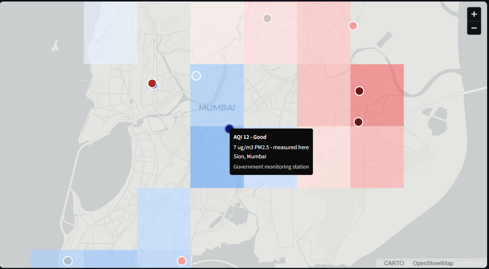

# Mumbai Air Quality

Interactive map of PM2.5 across the Mumbai metropolitan region, interpolating between the region's sparse ground monitors to estimate air quality at locations that have none. It shows the latest published CPCB readings by default and can be rewound to any hour in an 18-month history.

**Live app:** https://mumbai-air-quality.streamlit.app
**Repository:** https://github.com/yash-agx/mumbai-air-quality



---

## The problem

The Mumbai metropolitan region has roughly 20 million people and 39 usable PM2.5 monitors. That is one monitor per half-million people, spaced 1–40 km apart, and they are not spread evenly: they cluster near main roads and industrial land, because that is where regulatory interest sits.

So most of the city has no monitor, and the places without one are not a random sample of the places with one. Estimating what the gaps look like is the entire problem, and how well that can be done is the question this project actually answers: the answer is "less well than you would hope", for a reason that is measurable.

## Data

| | source | detail |
|---|---|---|
| History | [OpenAQ](https://openaq.org) v3 (republishing CPCB/MPCB/IITM) | 39 stations, 376,131 hourly readings, 2025-02-27 to 2026-08-27 (545 days) |
| Live | [data.gov.in](https://data.gov.in) CPCB real-time feed | rolling 24-hour average, republished each hour, matched to the same 39 stations by coordinates |
| Live fallback | [WAQI](https://waqi.info) map/bounds, then one station feed each | the same CPCB stations as US AQI over a single hour, converted back to µg/m³, used when data.gov.in is unreachable |
| Land use | [OpenStreetMap](https://www.openstreetmap.org) via Overpass | roads, coastline, industrial land use, building footprints |

Cleaning (`data/clean.py`) handles what actually breaks in this data rather than what is tidy to handle: missing hours, monitors offline for days, stuck sensors repeating one value for 24+ unbroken hours, near-coincident stations reported under different names by different agencies, and a residue of sensor artefacts that clear the physical plausibility check. That last one mattered: a saturation value of exactly 985.0 µg/m³ appeared as the maximum at five unrelated monitors, and isolated single-hour spikes appeared while the rest of the city sat at its usual ~23 µg/m³. Screening those two patterns changed RMSE from ~46 µg/m³ to ~21.

Six land-use features are computed per location from OSM (`scripts/02_features.py`), as a reusable function over any latitude/longitude so the same features serve both the 39 monitors and an arbitrary prediction grid: distance to the nearest major road, road density within 500 m and 1 km, distance to the coast, distance to the nearest industrial land use, and building density within 500 m.

## Method

Three models, each given exactly the same information, the readings from every other monitor at the hour being predicted:

- **IDW**: inverse distance weighting. The baseline. Its power is tuned per fold on training monitors only, because the conventional 1/d² is not its best setting here and a deliberately weak baseline would flatter everything else.
- **Kriging**: ordinary kriging on hourly-standardised values with one fitted exponential variogram.
- **Gradient-boosted trees**: on the six OSM features plus hour, day of week, month and the hour's citywide level. (I first planned a random forest; boosted trees give the same family of model at ~20× the fit speed, which is what made 35 folds tractable.) A fourth variant hands the trees the IDW estimate as an extra input, to test directly whether land use adds anything on top of distance weighting.

**Validation is leave-one-group-out, not leave-one-station-out.** Several monitors sit within a kilometre of each other. Two in Bandra East are ~70 m apart. Holding out one while its neighbour trains is not a spatial test: the model reads the answer off the neighbour across the street. Those are grouped, so the 39 monitors form 35 groups that are held out whole. The same rule applies to the inner loop that tunes the IDW power; without it, a 70 m partner leaks into the tuning.

**Where the map refuses to answer.** Each grid cell's six land-use features are compared against the range spanned by all 39 monitors; a cell outside that range on any feature gets no estimate, because nothing in the cross-validation score says what the model does in terrain it never saw. Two deliberate choices in that rule:

- The band is **min–max, not a percentile trim**. With 39 monitors, p01 sits just above the minimum, and 9 monitors fell outside their own band. The mask would have shaded ground where measurements exist.
- **A cell containing a monitor is always in-range**, whatever its features say. The mask flags places with no comparable training data, and a cell with a monitor in it has ground truth by definition. This is not hypothetical: the mask is evaluated at the cell centre, which at 2.3 km cells can sit most of a kilometre from the monitor, and 11 of 39 monitors landed in masked cells: Bandra Kurla Complex was excluded for a road density of 28.99 against a training maximum of 28.98, a margin of 0.035%. A percentage tolerance would have papered over it with an arbitrary number; the monitor rule follows from what the mask is for. It moves coverage from 81.3% masked to 79.8%, and leaves 0 of 39 monitors in a refused cell.

## Results

Pooled over 376,112 held-out station-hours across 35 folds:

| model | MAE (µg/m³) | RMSE (µg/m³) | vs IDW |
|---|---:|---:|---:|
| **IDW** | **11.229** | **21.117** | |
| Kriging | 11.293 | 21.168 | +0.24% |
| City average | 11.359 | 21.223 | +0.50% |
| Trees + IDW | 11.286 | 21.550 | +2.05% |
| Trees (land use only) | 11.385 | 21.608 | +2.33% |

"City average" is not a model. It is the plain mean of every reporting monitor that hour, included as the floor any spatial method has to clear.

**IDW wins, and nothing beats simply averaging the city by more than 0.5%.** Kriging beats IDW at 12 of 39 monitors; the trees at 13 of 39. Both differences are statistically detectable and practically irrelevant. Adding OSM land-use features made the estimate worse, not better.

## The finding: level is not spatially predictable, but timing is

Two results that only make sense together. They explain the table above, and they point in opposite directions. A third then asks *why* the second one holds, and comes back empty-handed.

### Hourly level: no spatial structure to exploit

Take each hour's readings, subtract that hour's citywide mean and divide by its spread. What remains is the purely spatial pattern with the shared "the whole basin is high tonight" signal removed. That residual field has almost no spatial structure at the distances between monitors:

| separation | pairs | semivariance |
|---|---:|---:|
| ~1.2 km | 10 | **0.96** |
| 3.7 km | 38 | 1.06 |
| 7.7 km | 99 | 1.05 |
| 12.6 km | 130 | 1.09 |
| 17.7 km | 114 | 1.08 |
| 24.4 km | 217 | 1.09 |
| 35.7 km | 133 | 1.07 |

Semivariance ~1.0 means two monitors are no more alike than two picked at random. The curve is flat beyond ~2 km. Even at the closest separation only about a tenth of the variance is spatially structured. The same shape appears in the raw, artefact-screened and log-transformed data, so it is a property of the field and not of outliers.

The closest monitor pairs outside the co-located groups are ~1 km apart and most are 5–40 km. **The correlation is gone before the second-nearest monitor.** There is very little for any interpolation method to exploit, which caps how far any model can get beyond "the city is at X right now", and kriging in particular cannot beat IDW, because the variogram it fits is nearly pure nugget.

Two caveats on that table. The nearest bin rests on 10 pairs, and those are exactly the near-coincident monitors that cross-validation holds out together, so the one bin showing structure is the one deliberately not exploited. And the fitted variogram is correspondingly unstable across folds: median nugget 0.95, range poorly identified anywhere from 2 km to the 300 km bound. That instability is itself the result; there is no well-defined range to find because there is almost nothing to fit.

The map is therefore described as *the city average, tilted slightly*, not a resolved street-level pollution field. The app says so in its own model card panel, and the grid is drawn at ~2.3 km cells rather than a smooth high-resolution raster that would imply more certainty than the data supports.

### Diurnal timing: location-specific, and thrown away

Ask about *when* each place peaks rather than *how high*, and the answer inverts. Averaging each monitor by hour of day, then removing that site's level and swing so only shape remains:

| comparison | median r | IQR |
|---|---:|---|
| Same monitor, independent halves of the record | **0.889** | 0.799–0.956 |
| Two different monitors | **0.504** | 0.259–0.683 |

The first row is a **noise ceiling**, and it is what makes the second row mean anything. A between-monitor correlation of 0.50 proves nothing by itself: profiles built from finite, gappy records are noisy, and removing each site's level and swing amplifies that noise, so 0.50 could be measurement error. Splitting each monitor's own record into odd and even days gives two independent estimates of the *same* profile, where the true shape is identical by construction. Correlating those measures how well a profile can be reproduced at all: r = 0.889. Different monitors reach only 57% of that ceiling (gap +0.385, Mann–Whitney p = 5.6×10⁻²⁰), so locations really do have distinct daily rhythms. A single common shape explains just 32.9% of the variance across the 39 sites, on a median day–night swing of 10.4 µg/m³.

**IDW cannot represent that.** An interpolated series is a fixed-weight average over all reporting monitors, so its diurnal shape is the citywide shape wherever it is computed. Measured at each monitor's own location, against the all-monitor average curve:

| | median r with the city curve |
|---|---:|
| Measured monitor | **0.758** |
| IDW estimate for the same spot | **0.997** |

The estimate reproduces the city's daily rhythm almost exactly and the local one not at all: the same mechanism as the flat variogram, but visible as a shape being flattened rather than a number being close.

**Both halves together are the result.** At this network's spacing the hourly level is not spatially predictable, while diurnal timing is location-specific and reliably measurable, and the interpolation discards the second along with the first. Local timing requires measurement at that location; interpolating between monitors 1–40 km apart will not recover it. The app's time-patterns section plots the measured and estimated curves as separate series so the gap is visible rather than asserted.

### Land use does not explain the timing, at least not detectably

If each site has its own daily rhythm, the obvious next question is whether the land around it sets that rhythm. Four tests were fixed in advance, each pairing one OSM feature with one summary of profile shape, with Benjamini–Hochberg correction across the four. They are computed on the window over which all 39 monitors report, with the full record kept as a sensitivity check:

| feature | shape summary | statistic | p | BH q |
|---|---|---:|---:|---:|
| `dist_coast_m` | trough hour | R = 0.363 | 0.106 | 0.372 |
| `road_density_500m` | morning–evening balance | ρ = −0.229 | 0.186 | 0.372 |
| `dist_industrial_m` | morning–evening balance | ρ = +0.091 | 0.598 | 0.797 |
| `building_density_500m` | day–night swing | ρ = +0.027 | 0.875 | 0.875 |

**None is significant, adjusted or not.** The unit of analysis is the cross-validation group rather than the station, so n = 35 rather than 39: near-coincident monitors are not independent observations of a land-use relationship, and counting them twice would understate every p-value.

**This is a limit on what 35 monitors can detect, not a demonstration that land use is irrelevant.** A permutation test at n = 35 reaches 80% power only around |ρ| = 0.48, and a true correlation of 0.30 would be missed about two times in three. Every effect measured here falls well inside that blind spot. The statement is that land-use features at 500 m–1 km explain no part of diurnal shape *large enough for this network to see*, not that there is nothing to explain.

**One control needed chasing, and it matters.** The tests assume diurnal shape is not itself spatially autocorrelated; if it were, a feature that is spatially structured could inherit geography's significance. A Mantel test on whether shape similarity decays with separation gives **opposite answers on the two time windows**. On the full 18-month record it is flat (r = +0.053, p = 0.518); on the common window it decays clearly (r = −0.215, p = 0.0009). Same monitors, same statistic, same code. The decay is confined to that one span: the same calendar months a year earlier give r = −0.046 (p = 0.59) on the same monitors at the same length, and every seasonal block in the record is flat, so the flat full-record result is the better-supported one, and it is the version consistent with the near-flat variogram above. Two things stop that being a clean close: the window's decay survives every internal check applied to it, and nothing identifies what was physically different about Mar–Aug 2026, so the four p-values above are still treated as possibly anticonservative.

## Follow-ups from public feedback

Four questions came back from a public post. All four were **pre-registered before any of them was run** — hypothesis, statistic, predicted direction, decision rule, and how many independent monitors each really rests on — in [`reports/preregistration_2026-11.md`](reports/preregistration_2026-11.md), committed on its own so the commit order is checkable. Everything below is reported as it came out, nulls included.

The unit is the cross-validation group throughout: **35 units, not 39 monitors**. At that n, a permutation test reaches 80% power only near |ρ| = 0.48, and the coastal contrast rests on 4 units within 2 km of the sea against 9 beyond 8 km, where even a 1.5 SD separation is detected barely two times in three. Read every null below as "no effect large enough for this network to see".

### 1. Sea breeze and land breeze: not supported

The idea: a daytime sea breeze pushes pollution inland and a night-time land breeze pushes it back over the coast, so coastal monitors should peak at night and inland ones in the afternoon.

**Peak hour against distance to the coast is null** — circular–linear R = 0.363, p = 0.106, n = 35. That number is not new evidence: peak and trough are one statistic twelve hours apart, so this is arithmetically the same test as `dist_coast_m` × trough hour in the table above, which was pre-specified and null then too. A secondary coastal-vs-inland comparison *is* significant (Mann–Whitney p = 0.020) but **in the opposite direction to the hypothesis** — the coastal units average an afternoon peak and the inland ones early morning — and it does not survive the full record (p = 0.711). Both groups are too scattered for their averages to mean much — the four coastal units peak at 11.0, 11.9, 12.0 and 20.2 h, the nine inland ones anywhere from 00:30 to 13:12 (concentration R̄ = 0.62 and 0.56) — so this is a difference between two loose spreads, not between two rhythms.

**Wind brings new information, and it does not support the hypothesis either.** Hourly 10 m wind for the same period came from the [Open-Meteo Historical Weather API](https://open-meteo.com/en/docs/historical-weather-api) (ERA5 reanalysis, free for non-commercial use). Hours were classified onshore (wind from 225°–315°, off the sea) or offshore (45°–135°, off the land), with calm hours below 1 m/s dropped.

In the common window, **the land breeze is essentially absent: 56 offshore hours out of 3,901 (1.4%)**, against 2,672 onshore. The window is March–August, when the monsoon flow is relentlessly westerly. Per the pre-registration, that count *is* the result for the primary window — there is no land breeze in it to test against. On the full record the dry season supplies 1,014 offshore hours (October–December alone contribute 697), and the test is null: **ρ = −0.235, p = 0.178, n = 34**. The sign is the predicted one; the effect is not resolvable at this n.

One result worth stating because it looks like a finding and is not. Every monitor, coastal and inland alike, reads about **+1 SD higher during offshore hours** — but offshore hours pile into October–December, which is also Mumbai's dirty season. An exploratory check (not pre-registered) that residualises within month *and* hour collapses the excess to **+0.08 SD**. The offshore signal was winter, not wind.

**Powai is the case the breeze story does not fit**, and it is the reason it was named in advance. It sits 5.8 km inland and peaks at 9 am — the breeze account predicts an afternoon peak there. It is also **1,083 m from the nearest major road, the furthest of all 39 monitors**, so the obvious alternative — a morning traffic peak — is the one explanation its own surroundings make least likely. Its offshore-minus-onshore difference is +0.94 SD, i.e. ordinary. This is one monitor; nothing about it is a test.

### 2. Do low-baseline monitors swing harder? Null

The hypothesis is that a monitor with a lower average PM2.5 shows a larger *percentage* day–night swing. The trap is that percentage swing is (max − min) / mean, so the baseline sits in the denominator: noise in the mean alone manufactures a negative correlation. The pre-registered primary is therefore a **split-half** — mean from odd days, percentage swing from even days — so the two statistics carry independent noise.

**Null: ρ = −0.306, p = 0.075 on the common window, and ρ = −0.094, p = 0.591 on the full record.** The direction is the predicted one and the window result is close to the line, but at n = 35 a true ρ of 0.3 is missed about two times in three, so this neither supports nor excludes the idea — it is exactly the size of effect this network cannot resolve.

Two diagnostics, reported as diagnostics and not promoted: the naive same-data version is *weaker* (ρ = −0.257, p = 0.138), so the artefact did not dominate here; and **absolute** swing in µg/m³ rises with the mean (ρ = +0.443, p = 0.008 on the full record), which is a different and much less interesting claim — dirtier places swing more in absolute terms.

### 3. Every curve is one instrument at one spot

A monitor is not a neighbourhood. The clearest case in this network: **two separate monitors carry "Malad West" in their name** — "Malad West" 31 m from a major road, and "Mindspace-Malad West" 546 m away, 1.4 km apart — and the diurnal chart's "Malad West" curve is the first of them, not the area. "Borivali East" and "Bandra Kurla Complex" likewise name two monitors each. Distance to a major road across the 39 monitors ranges from 4 m to 1,083 m (median 109 m). Treat every area label in this project as shorthand for the instrument.

<!-- generated by scripts/09_monitor_table.py -->

39 monitors, 35 independent units (monitors under ~1 km apart share a unit).

| Monitor | Agency | Lat, lon | Nearest major road | Coast | Hours |
|---|---|---|---|---|---|
| Bandra Kurla Complex, Mumbai † | IITM | 19.063, 72.846 | 27 m | 1.8 km | 8,327 |
| Bandra Kurla Complex, Mumbai | MPCB | 19.066, 72.862 | 56 m | 3.2 km | 11,074 |
| Bhayandar West, Mira-Bhayandar | MPCB | 19.296, 72.841 | 31 m | 2.1 km | 10,806 |
| Borivali East, Mumbai † | MPCB | 19.227, 72.864 | 101 m | 7.9 km | 8,575 |
| Borivali East, Mumbai † | IITM | 19.232, 72.869 | 571 m | 8.6 km | 11,773 |
| Byculla, Mumbai | BMC | 18.977, 72.838 | 361 m | 1.2 km | 11,128 |
| CBD Belapur, Belapur | MPCB | 19.024, 73.041 | 25 m | 2.5 km | 11,456 |
| Chakala-Andheri East, Mumbai | IITM | 19.111, 72.861 | 50 m | 3.9 km | 11,203 |
| Chembur, Mumbai | MPCB | 19.036, 72.895 | 24 m | 3.3 km | 11,145 |
| Chhatrapati Shivaji Intl. Airport (T2), Mumbai | MPCB | 19.101, 72.875 | 14 m | 5.1 km | 9,026 |
| Chinchpada, Ambernath | MPCB | 19.216, 73.200 | 932 m | 25.3 km | 3,296 |
| Deonar, Mumbai | IITM | 19.049, 72.923 | 267 m | 4.2 km | 10,115 |
| Ghatkopar, Mumbai | BMC | 19.084, 72.921 | 11 m | 4.1 km | 11,212 |
| Gokul Nagar, Bhiwandi | MPCB | 19.309, 73.057 | 285 m | 22.3 km | 11,640 |
| Kalu Nagar, Dombivli | MPCB | 19.227, 73.079 | 115 m | 15.6 km | 3,690 |
| Kandivali West, Mumbai | BMC | 19.216, 72.832 | 53 m | 4.2 km | 9,892 |
| Kasarvadavali, Thane | MPCB | 19.268, 72.972 | 265 m | 15.7 km | 11,661 |
| Khadakpada, Kalyan | MPCB | 19.253, 73.142 | 287 m | 22.4 km | 8,075 |
| Kherwadi_Bandra East, Mumbai † | MPCB | 19.063, 72.846 | 81 m | 1.8 km | 11,678 |
| Khindipada-Bhandup West, Mumbai | IITM | 19.164, 72.928 | 955 m | 6.1 km | 5,483 |
| Kopripada-Vashi, Navi Mumbai | MPCB | 19.090, 73.014 | 112 m | 3.0 km | 11,362 |
| Kurla, Mumbai | MPCB | 19.086, 72.889 | 156 m | 6.6 km | 9,646 |
| Mahape, Navi Mumbai | MPCB | 19.114, 73.009 | 6 m | 3.2 km | 10,519 |
| Malad West, Mumbai | IITM | 19.197, 72.822 | 31 m | 2.7 km | 11,724 |
| Mindspace-Malad West, Mumbai | MPCB | 19.188, 72.830 | 546 m | 3.6 km | 11,271 |
| Mulund West, Mumbai | MPCB | 19.175, 72.942 | 10 m | 6.2 km | 9,557 |
| Pimpleshwar Mandir, Thane | MPCB | 19.192, 72.959 | 341 m | 7.4 km | 4,468 |
| Powai, Mumbai | MPCB | 19.137, 72.915 | 1,083 m | 5.8 km | 8,792 |
| Sanpada, Navi Mumbai | MPCB | 19.058, 73.015 | 109 m | 2.1 km | 11,120 |
| Sector-2E Kalamboli, Navi Mumbai | MPCB | 19.026, 73.103 | 45 m | 7.9 km | 10,426 |
| Sewri, Mumbai | BMC | 19.000, 72.857 | 129 m | 0.4 km | 8,124 |
| Shivaji Nagar, Mumbai | BMC | 19.060, 72.923 | 85 m | 4.1 km | 11,018 |
| Siddharth Nagar-Worli, Mumbai † | IITM | 19.000, 72.814 | 203 m | 0.4 km | 10,884 |
| Sidhi Vinayak Nagar, Ulhasnagar † | MPCB | 19.236, 73.159 | 469 m | 22.6 km | 11,779 |
| Sion, Mumbai | MPCB | 19.047, 72.875 | 361 m | 3.8 km | 8,971 |
| Tondare-Taloja, Navi Mumbai | MPCB | 19.063, 73.121 | 4 m | 11.5 km | 11,071 |
| Upvan Fort, Thane | MPCB | 19.222, 72.958 | 14 m | 10.7 km | 11,593 |
| Vithalwadi, Ulhasnagar † | MPCB | 19.231, 73.155 | 93 m | 22.0 km | 3,676 |
| Worli, Mumbai † | MPCB | 18.994, 72.813 | 113 m | 0.0 km | 8,875 |

† 8 monitors in 4 near-coincident pairs, held out together in cross-validation and counted once in every test.

Distance to a major road ranges 4-1,083 m (median 109 m); to the coast 0.0-25.3 km.


### 4. Holding out whole months: the shipped model barely moves, the tree models do

The shipped cross-validation holds out whole `cv_group`s, so a model is scored on a monitor it never saw — but on hours it saw plenty of, through every other monitor. This adds a time axis: cells are (group, month), four months drawn with seed 0 (2025-07, 2025-11, 2025-12, 2026-03) crossed with all 35 groups, and the two schemes are scored on **exactly the same held-out rows**, differing only in whether the training data also excludes that month.

| model | gap, spatial only | gap, spatial + time | change | Wilcoxon p |
|---|---:|---:|---:|---:|
| `idw` | −0.158 | −0.138 | +0.020 | 0.068 |
| `kriging` | −0.100 | −0.036 | +0.064 | **0.0001** |
| `trees` | +0.718 | +1.410 | +0.693 | **0.009** |
| `trees+idw` | +0.627 | +1.271 | +0.644 | 0.070 |

The gap is model RMSE minus the city-average baseline's RMSE in µg/m³, averaged within each group and tested across the 35 groups; negative means the model beats the baseline, and a positive change means it lost ground when it could no longer train on the month it was scored in.

**The shipped model's advantage survives: IDW's gap narrows by 0.020 µg/m³, p = 0.068.** Kriging's degradation is statistically clear but numerically trivial (0.064 µg/m³ on a baseline RMSE of 21.4). The tree models lose about ten times as much, which is what was predicted in advance and for a mundane reason: IDW, kriging and the baseline all predict from *concurrent* readings at other monitors, so holding out a month can only reach them through fitted hyperparameters, while the trees genuinely learn across time — and `month` is one of their input features, so under this scheme they are asked about a month they never saw.

**The honest headline is how small the gaps are in the first place.** IDW beats the city-wide average by 0.158 µg/m³ of RMSE — under 1% of the 21.4 µg/m³ baseline — and the tree models never beat it at all. That is the same conclusion the spatial CV reached and the reason the app ships IDW alone: on hourly *level*, there is very little spatial structure here for any method to exploit, and holding out time does not change that verdict either way.

## Limitations

**Not all monitors report.** At the last check the live CPCB feed carried 17 of the 39 monitors. The app states how many are reporting and falls back to the most recent stored hour when the feed is unreachable.

**The monitor network is sited unlike the city it measures.** Monitors sit at roughly 2.7× the building density of typical inhabited ground (median 244.5 vs 90.4 buildings/km²) and 2.4× the road density, and the densest monitor lands at the 98th percentile of inhabited cells. Where the model extrapolates, it therefore mostly extrapolates *downward*, into quieter, greener, lower-traffic ground it has never seen. Any estimate for a calm residential pocket rests on monitors systematically busier than it, and nothing in the cross-validation score speaks to that, because every held-out monitor is itself one of these busy sites. Mumbai's dense neighbourhoods are largely inside the training range; the gap is at the quiet end.

**79.8% of the map is masked.** Grid cells whose land use falls outside the range spanned by all 39 monitors get no estimate. At the default resolution that is 266 cells of open water, forest and empty land (the bounding box is a rectangle over a coastal city, and 172 of those contain no mapped road or building at all), 128 cells that are built up but further from a road or industry than any monitor, and 105 for other reasons. The second group is the one worth knowing about; the app can colour the mask by group, and names the measurements behind each masked cell.

**A cell is only called empty when it is short of both buildings and road.** Either measurement alone used to be enough, and it mislabelled real neighbourhoods: every monitor stands in dense built-up Mumbai, so the floor sits at 40.7 mapped building footprints per km² within 500 m, and OSM under-maps dense informal housing as one polygon per block. A dense residential area in the northern suburbs came out as “open land, water or forest” on a building count of 26.7 against that floor, with its road density mid-range. Requiring both moved 192 cells out of that group at the default resolution — 100 to remote, 92 to other — and changed which cells are masked not at all.

**The AQI figures are a PM2.5 sub-index, not the official AQI.** CPCB defines the National Air Quality Index on a rolling 24-hour average, and takes the worst of eight pollutants. data.gov.in publishes that 24-hour average, so a figure from it sits on CPCB's window. The WAQI fallback and the stored history are both hourly, so a figure from either applies CPCB's breakpoints to one hour and moves around more. In all three cases the scale and category names are CPCB's and the number covers PM2.5 alone.

**What one live value covers depends on which feed answered, and the app says which.** A data.gov.in value is the average over the preceding 24 hours, which is what CPCB publishes: the same record carries the min and max across that window, and on 2026-11-11 all 25 Mumbai PM2.5 records spanned a median 252 µg/m³ between them, which no single hour can hold. So on that source the map shows where the last day has been worse or better, not where the air is worst this minute. A WAQI value is stamped at a single hour instead. Since data.gov.in blocks Streamlit Cloud, the deployed app is on WAQI and its wording says single-hour throughout; the 24-hour wording appears only when data.gov.in answers, which in practice means running it locally.

**Uncertainty scales with concentration, not distance.** Error against distance-to-nearest-monitor measured r = −0.02: being far from a monitor is not by itself a reason to distrust a cell. The error bar is calibrated on held-out monitors as a function of the predicted level instead.

**113 readings above 500 µg/m³ survive the artefact screen**, kept because the citywide median cleared the corroboration threshold that hour. Some are genuine episodes; a few clear the bar narrowly.

## Running it locally

Requires Python ≥3.12 (numpy 2.5 and scipy 1.18 do not build below it).

```bash
git clone https://github.com/yash-agx/mumbai-air-quality.git
cd mumbai-air-quality
python -m venv .venv && source .venv/bin/activate    # Windows: .venv\Scripts\activate
pip install -r requirements.txt
streamlit run app.py
```

The cleaned data, model card and precomputed masks are committed (~1.3 MB), so the app runs immediately without rebuilding anything.

For the **live view**, add a [data.gov.in](https://data.gov.in) API key to a `.env` file in the project root. Without it the app opens on the most recent stored hour and says so.

```
DATAGOV_API_KEY=your-key-here
WAQI_TOKEN=your-token-here
```

The data.gov.in key must be authorised for dataset access, not just registered: an unauthorised key returns `403 Key not authorised` and the app falls back with that message.

`WAQI_TOKEN` is the fallback live source and is optional locally. data.gov.in blocks requests from Streamlit Cloud's servers, so the deployed app cannot reach it even with a valid key, while it works from India. WAQI republishes the same CPCB stations, so the app tries it second and says which source the readings came from. WAQI reports the US EPA AQI rather than a concentration, so each station's PM2.5 sub-index is read from its own feed and converted back to µg/m³ with the pre-2024 EPA PM2.5 breakpoints. That conversion is approximate, because the AQI arrives as an integer: a converted value sits in a 1-2 µg/m³ bin at the clean end and a wider one higher up. The two feeds also cover different windows, and it shows: over the 13 stations reporting on both on 2026-11-11, the converted WAQI values ran a median 68 µg/m³ below data.gov.in, which publishes a 24-hour average where WAQI stamped a single hour. The same check could not tell the pre-2024 and 2024 EPA tables apart (MAE 74.8 against 75.5 µg/m³), so the documented pre-2024 scale is what the code uses. A free token comes from [aqicn.org](https://aqicn.org/data-platform/token/). On Streamlit Cloud both go under Settings > Secrets.

Air quality data from the [World Air Quality Index project](https://waqi.info/), CC BY-SA 4.0.

### Rebuilding the data pipeline

Only needed to refresh the history or change the feature set. Requires the extra dependencies and an [OpenAQ](https://openaq.org) key in `.env` as `OPENAQ_API_KEY`.

```bash
pip install -r requirements-dev.txt
python data/fetch.py            # OpenAQ pull -> data/raw/       (~10 min)
python data/clean.py            # clean + quality report -> data/processed/
python scripts/02_features.py   # OSM features via Overpass -> data/interim/
python model/interpolate.py     # cross-validation + model card (~6 min)
python model/interpolate.py --masks   # bake extrapolation masks for the app
```

The masks step is what keeps deployment small: it reduces 41 MB of OSM point clouds to a 7.1 KB file, because the mask answers a question whose answer never changes. The deployed app never loads OSM at all.

## Repository layout

```
app.py                     Streamlit dashboard
data/fetch.py              OpenAQ historical pull
data/clean.py              cleaning, artefact screen, quality report
data/live.py               live CPCB feed: data.gov.in, WAQI fallback
scripts/01_check_api.py    API reconnaissance
scripts/02_features.py     OSM land-use features for any lat/lon
scripts/03_diurnal_landuse.py  does land use explain diurnal shape? (null)
scripts/04_mantel_window.py    chasing the Mantel control disagreement
scripts/05_diurnal_chart.py    the standalone peak-hour chart
scripts/06_breeze.py       sea/land breeze, with Open-Meteo wind
scripts/07_baseline_swing.py   do low-baseline monitors swing harder?
scripts/08_timeblock_cv.py     cross-validation holding out whole months
scripts/09_monitor_table.py    the monitor table in this README
model/interpolate.py       IDW / kriging / trees, spatial CV, predict_surface
reports/preregistration_2026-11.md  what the last four tests promised to do
```

## Notes

Built with AI coding assistance. The research question, validation design and interpretation of results are my own.
