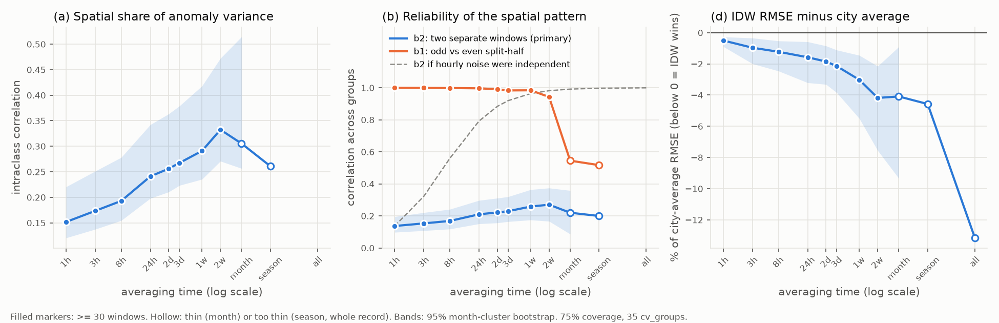

# Does spatial structure appear at longer averaging times?

Pre-registered in [`preregistration_averaging_times.md`](preregistration_averaging_times.md)
before anything was computed. Code: `scripts/11_averaging_times.py`. Full
numbers, including every interval and the 50% coverage sensitivity:
[`averaging_times.csv`](averaging_times.csv) and
[`averaging_times_distance.csv`](averaging_times_distance.csv).

## Short answer

**Partly, and less than the noise argument would predict.** Averaging longer
does make the spatial pattern somewhat more stable and does make IDW
somewhat more useful than the city average. But the pattern never becomes
strongly repeatable, and nearby monitors don't become detectably more alike
than distant ones. Under the pre-registered rules the result is **mixed**:
it fits none of the three readings fixed in advance.

## The table

75% coverage (primary). The unit is the cross-validation group (35);
"groups" is the median number of groups present per window. The bracketed
numbers are 95% month-cluster bootstrap intervals.

| window | data | windows | groups | share (raw) | share (ICC) | b1 split-half | b2 reliability | b2 pairs | near − far | Mantel p | city avg RMSE | IDW RMSE | IDW gap | gap % | Wilcoxon p |
|---|---|---:|---:|---:|---:|---:|---:|---:|---:|---:|---:|---:|---:|---:|---:|
| 1h | interpretable | 12,216 | 29 | 0.169 | 0.152 [0.120, 0.220] | 1.000 | 0.137 [0.098, 0.195] | 49,967 | +0.062 | 0.227 | 21.23 | 21.12 | −0.107 | −0.50 [−0.89, −0.27] | 0.026 |
| 3h | interpretable | 3,964 | 28 | 0.194 | 0.173 [0.137, 0.251] | 0.999 | 0.153 [0.108, 0.221] | 49,862 | +0.074 | 0.194 | 18.34 | 18.16 | −0.177 | −0.96 [−1.99, −0.34] | 0.174 |
| 8h | interpretable | 1,524 | 28 | 0.217 | 0.193 [0.154, 0.278] | 0.998 | 0.169 [0.118, 0.241] | 49,961 | +0.081 | 0.189 | 16.57 | 16.37 | −0.203 | −1.22 [−2.46, −0.53] | 0.060 |
| 24h | interpretable | 503 | 27 | 0.274 | 0.241 [0.198, 0.342] | 0.996 | 0.210 [0.151, 0.297] | 49,902 | +0.086 | 0.213 | 13.70 | 13.48 | −0.216 | −1.58 [−3.21, −0.58] | 0.012 |
| 2d | interpretable | 249 | 27 | 0.294 | 0.256 [0.210, 0.363] | 0.991 | 0.222 [0.157, 0.311] | 29,746 | +0.073 | 0.267 | 12.48 | 12.24 | −0.231 | −1.85 [−3.32, −0.85] | 0.016 |
| 3d | interpretable | 168 | 27 | 0.316 | 0.267 [0.223, 0.379] | 0.983 | 0.230 [0.165, 0.320] | 13,559 | +0.081 | 0.250 | 11.68 | 11.43 | −0.251 | −2.15 [−3.85, −1.11] | 0.002 |
| **1w** | interpretable | 72 | 27 | 0.349 | 0.291 [0.235, 0.418] | 0.984 | **0.258 [0.175, 0.364]** | 2,488 | +0.131 | **0.155** | 10.86 | 10.54 | −0.328 | **−3.02 [−5.50, −1.45]** | 0.004 |
| 2w | interpretable | 37 | 26 | 0.423 | 0.332 [0.271, 0.472] | 0.943 | 0.270 [0.167, 0.374] | 631 | +0.144 | 0.182 | 9.68 | 9.28 | −0.405 | −4.18 [−7.55, −2.15] | 0.001 |
| month | thin | 17 | 26 | 0.490 | 0.305 [0.257, 0.514] | 0.545 | 0.220 [0.087, 0.359] | 121 | +0.223 | 0.109 | 9.06 | 8.69 | −0.370 | −4.09 [−9.34, −0.91] | 0.087 |
| season | **too thin** | 5 | 27 | 0.597 | 0.261 | 0.517 | 0.200 | 6 | +0.336 | 0.020 | 8.66 | 8.27 | −0.396 | −4.57 | 0.002 |
| all | **too thin** | 1 | 24 | 1.000 | — | — | — | 0 | +0.661 | 0.023 | 4.58 | 3.98 | −0.603 | −13.16 | 0.121 |

What sits behind each row:

- **Stations.** All 39 monitors contribute at 1h–month, 37 at season and 24
  at the whole record. The whole-record window keeps only monitors with 75%
  of all hours.
- **Distance pairs.** The near − far contrast compares 44 cross-group pairs
  under 5 km with 464 pairs at 15 km or more (38 and 411 at month; 19 and
  200 at season; 17 and 182 for the whole record).
- **CV station-windows.** 375,872 at 1h, 14,679 at 24h, 2,049 at 1w, 461 at
  month, 138 at season and 24 for the whole record.
- **Wilcoxon p.** Signed-rank test across the per-group IDW − city-average
  RMSE gaps (35 groups; 33 at season, 24 for the whole record).

**Too thin to interpret.** The season row (5 windows) and the whole-record
row (1 window) are description only, as fixed in advance. Their striking
values are what one or five snapshots of 24–37 monitors produce, and nothing
should be built on them:
- distance contrast +0.34 and +0.66, Mantel p ≈ 0.02;
- IDW gap −4.6% and −13.2%.

The month row (17 windows) is thin: its intervals are wide, and it isn't
decisive on its own.

## The pre-registered reading

| criterion | result | met? |
|---|---|---|
| C1: b2(1w) − b2(1h), interval excludes 0 | +0.121 [+0.068, +0.178] | yes: the pattern does get more stable |
| b2 stays < 0.2 at every interpretable window (reading 1) | reaches 0.21–0.27 from 24h to 2w | no: not "noise all the way down" |
| b2(1w) ≥ 0.3 (needed for readings 2 and 3) | 0.258 [0.175, 0.364] | **no** |
| distance contrast at 1w > 0 with p < 0.05 | +0.131, p = 0.155 | no |
| C2: IDW gap % at 1w minus 1h, interval below 0 | −2.52 pp [−4.72, −1.03] | yes: IDW gains with averaging |

**Verdict: mixed.**
- Stable structure does grow with averaging, so this is not reading 1. But
  at one week it reaches only about a quarter of a window's pattern, short
  of the 0.3 bar that readings 2 and 3 both need.
- IDW's edge over the city average does widen, from 0.5% of RMSE at 1h to
  3.0% at a week and 4.2% at two weeks. In absolute terms that is 0.11 to
  0.33 to 0.41 µg/m³.
- Yet the distance contrast is not significant at any interpretable window.

**The skill result does not survive the coverage sensitivity.** At 50%
coverage C1 holds (+0.108 [+0.063, +0.159]), but **C2 does not: −0.77 pp
[−3.17, +0.54]**. IDW's 1-week gap there is −1.27% instead of −3.02%.
Letting in station-weeks with half their hours missing makes the window
means noisier, and the IDW gain mostly goes away. So the growth in skill
with averaging time is real at the primary coverage rule but fragile.

## In plain English

The reviewer's idea is that hourly noise hides stable differences between
places, so longer averages should reveal them. If that were the whole
story, the effect would be dramatic:
- An hourly pattern with reliability 0.14 should reach about 0.8 when
  averaged over a day and about 0.96 over a week, if the hour-to-hour noise
  were independent. That is the dashed line in panel (b).
- What actually happens: 0.21 at a day, 0.26 at a week, and no higher
  after that.

So most of what makes one hour's map unlike another's is not noise that
averages away. It is a pattern that **persists for days to weeks and then
changes**. One fortnight's map of which neighbourhoods are relatively dirty
shares only about a quarter of its structure with a fortnight a few weeks
later.

There *is* a stable part. The long-run average difference between monitors
is very reproducible (split-half ≈ 0.98 up to a week, though inflated at
short windows, as predicted). And by a week roughly 30% of a window's
spatial variance is stable between groups, against 15% at an hour. Longer
averages help IDW a little: its tuned power rises from 0.5 to 1.5, which
means it leans more on nearby monitors. But nearby monitors are still not
detectably more alike than distant ones at this network's 2–40 km spacing.

The fair summary is this. The main result, no exploitable spatial structure
in hourly PM2.5, is mostly but not entirely an hourly statement. At weekly
and longer averages there is a modest, real, stable component, and IDW
beats the city average by a few percent instead of half a percent. It is
still not a smooth field that interpolation between monitors 1–40 km apart
can recover with much confidence.

## Exploratory, not pre-registered

None of these count as findings. They are recorded because they bear on how
to read the above.

- **The four near-coincident monitor pairs grow *less* alike with
  averaging.** These monitors are 0.55 km apart on average, some only about
  70 m, and are held out together in CV. Their spatial correlation (1 − γ)
  goes from −0.24 at 1h to −0.72 at 1w and about −1.15 at a month. Monitors
  this close cannot be sampling different air. So they carry **stable
  offsets from the instrument or its immediate siting**, which longer
  averages expose instead of cancelling. Some of the stable between-place
  differences measured above are therefore probably instrument
  differences, not air. Only 4 pairs, so this is a lead, not a result.
- **The 6 cross-group pairs under 2 km** go the other way, from +0.22 at 1h
  to +0.50 at 1w. That is the only distance bin with consistently positive
  correlation, and it is too few pairs to carry a test. Beyond 2 km every
  bin stays at or below zero at every interpretable window.
- **b1 falls off at month** (0.55, 17 windows). Odd and even months fall in
  different parts of the monsoon cycle. This is consistent with the
  persistence-then-change picture above: what's stable at the scale of a
  few weeks is not stable across seasons.

## Checks

- At 1h the distance pattern reproduces the main variogram. Pooling the
  same-group and 0–2 km rows gives semivariance 0.961 against the README's
  0.96, and the later bins give 1.05–1.09 against 1.05–1.09.
- At 1h the CV reproduces the shipped figures: IDW 21.119 and city average
  21.225 µg/m³, against 21.117 and 21.223 shipped. The only difference is
  the ≥ 10-station rule, which drops 240 of 376,112 station-hours.
- A first full run had a bug: windows were anchored at 2025-03-01 instead of
  the pre-registered 2025-02-28 00:30. The window counts didn't match the
  pre-registration (2d: 255 against 249), which is how it was caught. The
  anchor was fixed to the pre-registered one and everything was re-run. The
  numbers above come from the corrected run, and every window count matches
  the pre-registration.
