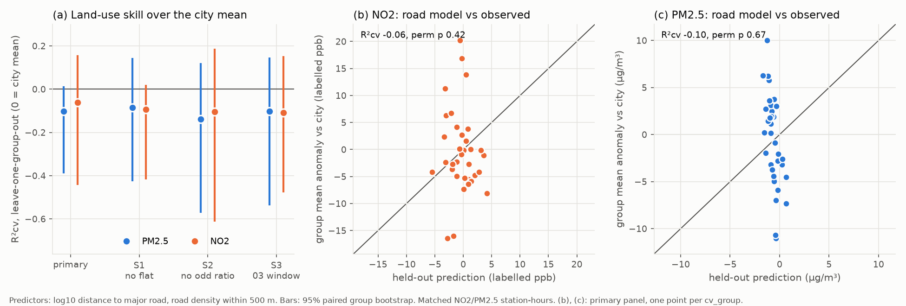

# Does land use explain NO2 better than PM2.5?

Pre-registered in [`preregistration_no2_landuse.md`](preregistration_no2_landuse.md)
before any NO2 vs land-use relationship was computed. Code:
`scripts/13_no2_landuse.py`, which reuses the machinery of the PM2.5 land-use
tests (`scripts/03_diurnal_landuse.py`) and the cleaning and matched panel of
the NO2 control (`scripts/12_no2_positive_control.py`). Tests:
`tests/test_no2_landuse.py`. Full numbers:
[`no2_landuse.csv`](no2_landuse.csv) (every panel, outcome and pollutant),
[`no2_landuse_groups.csv`](no2_landuse_groups.csv) (each group's values and
held-out predictions) and
[`no2_landuse_spearman.csv`](no2_landuse_spearman.csv) (per-feature and
exploratory tests).

## Short answer

**Roads do not explain the differences between monitors, for NO2 or for
PM2.5.** Each pollutant was given two road features fixed in advance:
distance to the nearest major road, and road density within 500 m. With
those, each monitor's long-run offset from the city is predicted *worse*
than by assuming it sits at the city mean. For NO2, R²cv is −0.06
(permutation p = 0.42). For PM2.5 it is −0.10 (p = 0.67). The NO2-minus-PM2.5
difference is +0.04, with interval [−0.31, +0.38], so the data cannot tell
the two apart.

All four variants (primary, S1, S2, S3) and both outcomes give **reading L3:
no detectable land-use signal**.

What makes this more than "too little data": NO2's between-monitor
differences are **large and almost perfectly repeatable**. The split-half
reliability of the anomaly between odd and even days is 0.999. So there is a
stable pattern to explain, and the road environment at the monitor's mapped
position does not explain it.

## Primary result (matched panel, anomaly outcome)

39 monitors, 35 `cv_group`s, 361,801 matched station-hours. Leave-one-group-out
against the city mean. Brackets are 95% paired group-bootstrap intervals
(2,000 resamples). p is the one-sided permutation p (20,000 shuffles),
BH-adjusted across the two pollutants.

| | NO2 | PM2.5 |
|---|---:|---:|
| R²cv | **−0.062** [−0.442, +0.157] | **−0.101** [−0.390, +0.014] |
| RMSE, city mean → road model | 7.86 → 8.11 (labelled ppb) | 4.85 → 5.09 µg/m³ |
| permutation p (BH) | 0.42 (0.67) | 0.67 (0.67) |
| coefficient, log₁₀ distance to major road (t) | −2.28 (−1.12) | −0.53 (−0.40) |
| coefficient, road density 500 m (t) | +0.23 (+1.16) | −0.04 (−0.29) |
| split-half reliability (odd vs even days) | 0.999 | 0.995 |
| Mantel, \|Δ anomaly\| vs distance | −0.157, p = 0.097 | +0.082, p = 0.30 |

**Primary contrast D = R²cv(NO2) − R²cv(PM2.5) = +0.039 [−0.313, +0.384]**,
with 41% of resamples at or below 0.

NO2's coefficients point the way the physics expects: lower further from a
major road, higher with more road around. But they are small next to their
uncertainty, and out of sample they do not beat the city mean. PM2.5's
distance coefficient is also negative, and its density coefficient is close
to zero.

**The secondary outcome (long-run level) agrees:** NO2 R²cv −0.046 (p = 0.32),
PM2.5 −0.051 (p = 0.33), D +0.005 [−0.390, +0.384]. Reading L3.

**Per-feature Spearman (03's test, BH across the 8):** every |ρ| ≤ 0.15, and
every adjusted p = 0.92. For the NO2 anomaly: ρ = −0.04 with log distance and
+0.06 with road density.

## Sensitivities

| variant | monitors / groups | NO2 R²cv (p) | PM2.5 R²cv (p) | D [95%] | reading |
|---|---:|---:|---:|---:|---|
| primary | 39 / 35 | −0.062 (0.42) | −0.101 (0.67) | +0.039 [−0.313, +0.384] | L3 |
| S1 no near-flat NO2 sensors | 35 / 31 | −0.093 (0.55) | −0.085 (0.47) | −0.008 [−0.410, +0.303] | L3 |
| S2 no odd NO2/NOx ratio | 29 / 27 | −0.103 (0.51) | −0.138 (0.67) | +0.034 [−0.522, +0.493] | L3 |
| S3 03's window (Mar–Aug 2026) | 36 / 33 | −0.109 (0.75) | −0.101 (0.63) | −0.007 [−0.422, +0.501] | L3 |

(Anomaly outcome; p unadjusted here, and BH-adjusted values are all ≥ 0.55.
The level outcome gives L3 in every variant as well; see the CSV.)

In S2, NO2's fitted road effects **reverse sign** (log distance +1.65,
density −0.05, both |t| < 1). On the 27 groups whose NO2/NOx ratio looks
consistent, there is no hint of a road gradient at all. In S3, three
monitors have under 2,000 matched hours in the shorter window and drop out,
as the pre-registered hour rule requires.

## Against the prediction

| prediction | result | right? |
|---|---|---|
| Primary reads L3, with R²N < 0.15, pN ≥ 0.05, D interval including 0 | L3. R²N = −0.06, pN = 0.42 (BH 0.67), D [−0.31, +0.38] | **yes** |
| S2 raises R²N by ≥ 0.10 over the primary, and R²P by less | R²N goes from −0.062 to −0.103 (**−0.04**); R²P from −0.101 to −0.138 | **no** |

The S2 prediction was the one that said the odd-ratio monitors were *hiding*
a road signal. They are not: removing them makes NO2 slightly worse, not
better. If NO2 data quality is the problem, it is not confined to those ten
monitors.

## What a null at n = 35 can and cannot rule out

From the pre-registered power simulation:
- the skill test catches a true R² of 0.3 89% of the time and a true R² of
  0.4 99% of the time;
- NO2's bootstrap interval tops out at +0.16.

So **a strong road signal in NO2 (true R² of about 0.3 or more) is unlikely
on this network**. One of the size that European NO2 land-use studies
commonly report (R² 0.5–0.8) is very unlikely. A modest one (R² ≈ 0.1–0.2)
cannot be excluded: the test would miss it a third to two-thirds of the time.

The NO2-vs-PM2.5 contrast is **not resolvable at this n**, as stated in
advance. Its interval spans −0.31 to +0.38, and even a true NO2 R² of 0.5
against 0 for PM2.5 would be detected only 70% of the time. This result does
not say "land use explains NO2 no better than PM2.5". It says this network
cannot show the difference, and that NO2 shows no road signal of its own.

## Reading it together with the NO2 control

- **The expert's premise does not show up here.** If NO2's local structure
  were real and readable at these monitors, the road environment should
  predict which monitors run high. It does not, even though the
  between-monitor differences are large and stable.
- **That is consistent with "something about the data", but does not prove
  it.** A stable offset that roads do not explain can come from three
  sources, and this test cannot tell them apart:
  1. **Siting below the resolution of the features.** Kerb distance, inlet
     height, a car park or a canyon next to the inlet: these act over metres,
     and `dist_major_road_m` sees only OSM road centrelines.
  2. **Monitor coordinates.** Four monitors carry only 3 decimal places in at
     least one coordinate (±50–100 m) and eight carry 4 or fewer. At a
     median distance to road of 112 m, that is enough to blur the distance
     feature badly at the monitors it affects (exploratory, see below).
  3. **Instrument offsets.** A sensor whose calibration differs keeps the
     same relative anomaly every hour, exactly the "stable between-place
     difference" that the split-half check rewards. The NOx scaling problem
     shows this network has such offsets, and S2's failure shows they are not
     confined to the ten monitors the ratio flags.
- **PM2.5 gets no road signal either.** This agrees with the shipped model,
  where adding OSM land use made hourly PM2.5 estimates worse, and now holds
  for the long-run offset too.

## Exploratory, not pre-registered

- **The four near-flat sensors have some of the largest NO2 anomalies, and
  they do not agree with each other.** Mahape: +20.2, 6 m from a major road.
  Powai: −16.4, 1.08 km from one with almost no road around it (0.42 km/km²).
  Both fit a road story. Kurla: −16.0 at 156 m. Mulund West: −8.1 at 11 m.
  These two contradict it. All four are also in the odd-ratio list, which is
  why S2 removes them as well.
- **Six features do not help.** An OLS on all six features (distances
  log-transformed) gives R²cv −0.32 for NO2 and −0.33 for PM2.5, both
  p ≈ 0.72. The other four features one at a time: every |ρ| ≤ 0.17, every
  p ≥ 0.33.
- **Coordinate precision** (above) was checked after the result, to look
  for an explanation, and is not part of any test.

## Deviations and corrections

- **Matched station-hours: 361,801, not 364,177.** The pre-registration
  quoted 364,177 from the text of `no2_positive_control.md`. The panel used
  here is the one in that control's own CSV (`station_hours` = 361,801 for
  both matched panels). The two scripts build it identically. The 364,177 in
  the control's text does not match the control's CSV, and is the number in
  error.
- **Reading-rule overlap.** The pre-registered table does not say which
  reading wins when both pollutants are null (L3) but the contrast interval
  lies wholly below 0 (one arm of L4). The code flags that case as an overlap
  rather than choosing after the fact. It did not occur in any variant.
- **Split-half minimum hours.** The pre-registration did not fix an hour
  floor for each half. Half the full-record floor (1,000 hours) was used.
  Every reliability value is ≥ 0.99, so this choice cannot have mattered.
