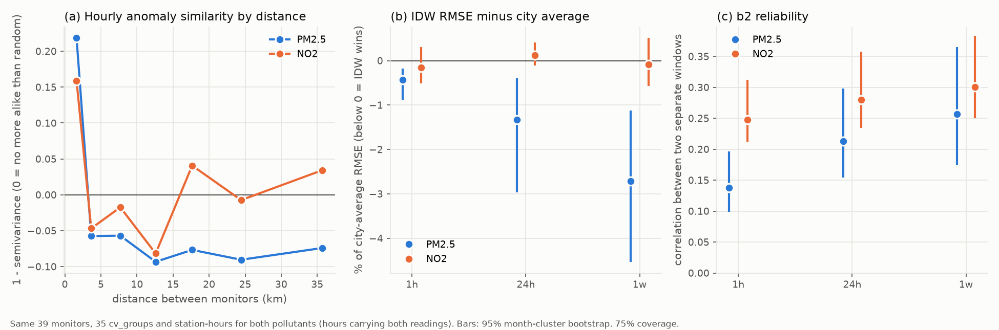

# NO2 as a positive control

Pre-registered in [`preregistration_no2.md`](preregistration_no2.md) before any
NO2 value was looked at. Code: `scripts/12_no2_positive_control.py` (data pull:
`data/fetch_no2.py`). Full numbers, including every panel and sensitivity:
[`no2_positive_control.csv`](no2_positive_control.csv) and
[`no2_positive_control_distance.csv`](no2_positive_control_distance.csv).

## Short answer

**The positive control failed.** NO2 was expected to vary between places much
more than PM2.5. On the same 39 monitors and the same hours, it does not do
so clearly on any of the three measures:

- **Nearby monitors are not more alike in NO2.** NO2's distance pattern is
  flat, and slightly flatter than PM2.5's.
- **IDW does not beat the city average for NO2,** at 1 hour, a day or a week.
  For PM2.5 it does, by a small margin.
- **NO2's pattern is somewhat more repeatable at 1 hour,** but under the
  pre-registered bar of twice PM2.5's value, and not at 1 week. Most of even
  that gap comes from four near-flat NO2 sensors (exploratory check below).

Under the pre-registered rules this is **reading R4: control fails**. So
this network and method cannot show that the PM2.5 null is "real and not a
blind spot". The more likely reading is that at 1–40 km spacing this network
cannot see local structure for any pollutant.

## Side by side (primary: matched panel)

Same 39 monitors and 35 `cv_group`s, and the **same station-hours for both
pollutants**: an hour at a monitor is used only if both a cleaned PM2.5 and a
cleaned NO2 reading exist (361,801 station-hours after cleaning both
pollutants, before the per-window coverage rule; 364,177 before NO2
cleaning). Brackets are 95% month-cluster bootstrap intervals, 1,000
resamples, with the same resamples for both pollutants, so the difference
column is a paired interval. 75% coverage, ≥ 10 monitors per window.

| measure | window | PM2.5 | NO2 | NO2 − PM2.5 |
|---|---|---:|---:|---:|
| **b2 reliability** | 1 h | 0.138 [0.099, 0.197] | 0.248 [0.212, 0.312] | **+0.110 [+0.057, +0.170]** |
| | 24 h | 0.213 [0.154, 0.298] | 0.280 [0.235, 0.357] | +0.067 [−0.012, +0.157] |
| | 1 week | 0.257 [0.174, 0.365] | 0.301 [0.250, 0.384] | +0.044 [−0.058, +0.150] |
| **near − far similarity** (< 5 km vs ≥ 15 km) | 1 h | +0.063, Mantel p = 0.226 | −0.035, p = 0.626 | −0.098 [−0.222, +0.011] |
| | 24 h | +0.096, p = 0.189 | −0.090, p = 0.735 | — |
| | 1 week | +0.163, p = 0.102 | −0.052, p = 0.639 | — |
| **IDW gap, % of city-average RMSE** (below 0 = IDW wins) | 1 h | −0.43 [−0.88, −0.18] | −0.16 [−0.52, +0.31] | +0.27 [−0.27, +1.07] |
| | 24 h | −1.33 [−2.97, −0.39] | +0.12 [−0.12, +0.41] | **+1.45 [+0.43, +3.22]** |
| | 1 week | −2.72 [−4.53, −1.12] | −0.09 [−0.57, +0.51] | **+2.63 [+1.08, +4.78]** |

What sits behind each number:

| window | windows (hours) | median monitors / groups per window | b2 window pairs | CV station-windows | distance pairs, near / far |
|---|---:|---:|---:|---:|---:|
| 1 h | 12,216 | 30 / 28 | 49,957 | 361,557 | 44 / 464 |
| 24 h | 503 | 28 / 26 | 49,815 | 13,758 | 44 / 464 |
| 1 week | 72 | 27 / 25 | 2,486 | 1,905 | 44 / 458 |

All 39 monitors and all 35 groups contribute at every window. Each pollutant
is scored on the same rows. RMSEs at 1 h: PM2.5 21.26 (city average) and
21.17 (IDW) µg/m³; NO2 19.17 and 19.14 in the labelled unit. Per-group
Wilcoxon p for the IDW gap at 1 h: PM2.5 0.044, NO2 0.033. The NO2 one is
significant across groups even though its pooled interval includes 0. The
pooled number is the one the decision rule uses.

**Code check (pre-registered).** PM2.5 on its own availability reproduces
`averaging_times.csv` exactly: b2 0.137 (1 h) and 0.258 (1 w), IDW gap
−0.50% (1 h) and −3.02% (1 w).

## The pre-registered reading

| criterion | result | met? |
|---|---|---|
| **S** D b2(1 h) interval above 0 | +0.110 [+0.057, +0.170] | yes |
| **S** D b2(1 w) interval above 0 | +0.044 [−0.058, +0.150] | **no** |
| **S** NO2 b2(1 h) ≥ 2 × PM2.5 b2(1 h) | 0.248 / 0.138 = 1.79× | **no** |
| **G** NO2 near − far(1 h) > 0 with Mantel p < 0.05 | −0.035, p = 0.626 | **no** |
| **G** D near − far(1 h) interval above 0 | −0.098 [−0.222, +0.011] | **no** |
| **P** NO2 IDW gap %(1 h) interval below 0 | −0.16 [−0.52, +0.31] | **no** |
| **P** D gap %(1 h) interval below 0 | +0.27 [−0.27, +1.07] | **no** |
| **P** NO2 IDW gap %(1 h) ≤ −2% | −0.16% | **no** |

**S, G and P are all unmet: reading R4, control fails.** NO2 does not show
clearly more structure than PM2.5. The prediction was R2 (stability only),
and it was wrong on S as well.

Both pre-registered sensitivities give the same reading:

| sensitivity | D b2(1 h) | b2 ratio | D b2(1 w) | NO2 gap % (1 h) | reading |
|---|---:|---:|---:|---:|---|
| no spike screen | +0.109 [+0.056, +0.170] | 1.79 | +0.043 [−0.059, +0.150] | −0.15 [−0.50, +0.30] | R4 |
| zeros dropped (zeros were 2.3% of rows, over the 1% trigger) | +0.116 [+0.061, +0.180] | 1.84 | +0.046 [−0.058, +0.157] | −0.25 [−0.67, +0.28] | R4 |

## What the cleaning did

NO2, inside the window: 762 QA-flagged rows, 34 nulls and 4 negative values
dropped; 8,699 exact zeros kept (2.3%). No value was the maximum at three or
more monitors, so the saturation rule removed nothing. 47 lone spikes were
removed at 20 monitors. 3,268 hours were masked as stuck runs. 380,970
station-hours remain. Most of the stuck hours are runs of exact zeros: with
zeros dropped first, the stuck mask removes only 856. Levels, for context:
median 14.5, 90th percentile 43.4 in the labelled unit.

## Exploratory, not pre-registered

### Four NO2 sensors barely move, and they carry most of NO2's extra b2

Four NO2 monitors have an hourly coefficient of variation under half the
network median (0.85): Powai, Kurla, Mulund West and Mahape. Powai, for
example, sits between 5.9 and 6.3 at the median and 90th percentile. Values
like that wobble instead of repeating exactly, so the 24-hour stuck rule does
not catch them. A sensor that hardly moves keeps nearly the same anomaly
relative to the city every hour, which is exactly what b2 rewards.

Without those four (35 monitors, 31 groups, the same matched rule;
[`no2_positive_control_flat.csv`](no2_positive_control_flat.csv)):

| | PM2.5 | NO2 | NO2 − PM2.5 |
|---|---:|---:|---:|
| b2, 1 h | 0.118 | 0.132 | +0.014 [−0.041, +0.080] |
| b2, 1 week | 0.240 | 0.180 | −0.060 [−0.178, +0.064] |
| near − far, 1 h | +0.109 (p = 0.086) | −0.053 (p = 0.670) | −0.162 [−0.299, −0.036] |
| IDW gap %, 1 h | −0.67 | −0.31 | +0.36 [−0.29, +1.28] |

On reliable-looking sensors, NO2's spatial pattern is **no more repeatable
than PM2.5's** at 1 hour, and less at 1 week. The flatness rule was chosen
after seeing the main result, so this does not replace the primary. It only
says the one partial signal in the primary is mostly sensor behaviour. (On
this 35-monitor subset PM2.5's 1-week distance contrast reaches p = 0.049.
That is one of many exploratory numbers and nothing is built on it.)

### NOx is not usable: its scale differs from station to station

NOx was a pre-registered secondary control. By the decision rules it would
read R2 (b2 0.511 against PM2.5's 0.137 at 1 h). **That number is not
interpretable**, and was checked after the run because its RMSE (~1.2) was
impossibly small next to NO2's (~19), when NOx = NO + NO2 must be at least as
large:

- Every NOx sensor is labelled ppb but reports values around 0.01, a
  ppm-like scale.
- On hours where both are reported, the ratio NOx × 1000 ÷ NO2 has a floor near
  0.53 = 1/1.88 at most of 29 monitors. That is what NOx in ppm and NO2 in
  µg/m³ would give.
- At the other 10 monitors the ratio sits instead at 1.7–3.9, mostly not at any
  standard conversion factor. At some (Kurla, Khadakpada) NOx is a fixed
  multiple of NO2 with correlation 1.000, so there it is not an independent
  measurement. Eight of those ten are monitors that also list an older,
  retired NO2 sensor labelled µg/m³.

A scale factor that differs by monitor creates exactly the "stable
between-place difference" that b2 measures. So NOx's high b2 is at least
partly an artefact. No single unit error explains the pattern, so **no
correction was applied**, and NOx is reported here as uninterpretable rather
than as evidence for anything.

The same ratio cannot say which channel is off at those ten monitors. If
NO2 itself were mis-scaled at some of them, that would *inflate* NO2's b2, so
it pushes toward passing the control. NO2 failed anyway. NO2 was not
changed.

## What this means for the method

- **The method is not blind in principle.** At 1 hour it did register NO2's
  pattern as more repeatable than PM2.5's, the expected direction. With NOx,
  it registered a large difference when one was present, even an artefactual
  one. A stable offset between monitors is visible to b2.
- **But no smooth spatial structure appeared for either pollutant.** For
  NO2, nearby monitors are no more alike than distant ones, and IDW gains
  nothing. That fits what is known about NO2 near roads: concentrations fall
  off over tens to hundreds of metres, far below the 1–40 km between these
  monitors. At this spacing, a pollutant with strong local structure and one
  without look the same.
- **So the PM2.5 nulls cannot be called "not a blind spot".** The design
  that finds no exploitable PM2.5 structure also finds none for the pollutant
  that should have the most. The honest statement is about the network:
  monitors 1–40 km apart cannot resolve local structure, whichever pollutant
  carries it. The earlier finding that PM2.5 at weekly averages carries
  slightly more exploitable structure than hourly still stands. Here, PM2.5
  in fact beats NO2 on IDW skill at 24 h and 1 week.
- **Data quality limits the control as well.** Four NO2 sensors are near-flat
  and NOx is inconsistently scaled. CPCB/OpenAQ NO2 at this network is a
  weaker reference than a positive control should be.
